# Riichi Open I — registration, standings and admin plan

Planning date: 15 October 2026. Target repository: `C:/Projects/others/saujana-bgc.github.io`.

Implementation record: the registration and standings pages, shared admin shell, tournament Edge Functions and Supabase migration are deployed. The migration is applied to the configured Supabase project, both Edge Functions are active, and the GitHub Pages deployment is live at `https://saujana-bgc.github.io/`.

## 1. Confirmed requirements

| Item | Decision |
|---|---|
| Event | Riichi Open I |
| Date and start | Saturday, 14 November 2026, 2:30 PM, Asia/Kuala_Lumpur |
| Venue | Boardroom Bandit, Ara Damansara |
| Entry | RM10 |
| Prize | Prize for the winner; type/value unspecified |
| Capacity | 16 participants |
| Capacity accounting | Registrations awaiting verification reserve places |
| Participant accounts | None required |
| Registration fields | Name and payment receipt |
| Payment instructions | Touch ’n Go or DuitNow to +60162459482 |
| Expected recipient | NICHOLAS, as supplied by the organiser |
| Public registrants | Show submitted registrations, labelled pending or verified |
| Receipts | Stored in Supabase Storage; accessible to authorised admins |
| Public results | Certified results only |
| Admin | Add participants, inspect receipts, verify payments, enter results and certify rounds |
| Admin organisation | One master admin area for Birthday Club and Riichi Open, using the existing birthday-calendar account and protection logic |

No registration deadline was supplied. Proposed default: registration stays open until the admin closes it, the places are reserved, or the playing roster is locked for the event. No automatic waiting list or refund system in the initial scope.

Tournament rules source: `C:/Projects/saujanabgc/riichi-open/rules.md`. That guide governs scoring, seating, qualification, penalties and the final. The annual league is a separate competition.

## 2. What can be reused

- Existing Nuxt 4 site, statically generated to GitHub Pages. The public tournament pages use the shared site layout; organiser tools share a master admin area.
- Existing Supabase project `gjucszyfwcpsquirxooq` for Postgres, Auth, Storage and Edge Functions.
- Website styling from `assets/css/main.css`: ivory, matcha green, bronze, Playfair Display, Segoe UI and rounded cards.
- Reuse the existing birthday-calendar Supabase account and its server-managed `app_metadata.role = birthday_admin` authorisation for the master admin area and both modules. The role keeps its existing legacy name; the user explicitly wants the same protection and credentials across these tools. No second account or event-admin membership system is required for this initial release. Do not overwrite the role or loosen the birthday data policy.
- Existing league page offers useful responsive table/card presentation patterns, but its public result-entry functions and scoring assumptions must not be reused for this tournament.

Important implementation findings:

1. `composables/useSupabase.js` is a custom REST client, not the official SDK. Its public singleton sends the publishable key as the bearer token. Leave working public pages using it; add authenticated request/storage helpers that use the current token from the shared admin session. A public API key must never substitute for a signed-in admin token.
2. Extract authentication/session responsibilities from `composables/useBirthdayAdmin.js` into `useAdminAuth`. Preserve its existing username-to-account mapping, Supabase password sign-in, server-managed role check, remember-me choice, session validation and token refresh. Keep birthday fetching in a focused data composable; new tournament admin data calls use the same shared auth state rather than a second login.
3. The only current Storage bucket is `albums`, and it is public. Create a separate private receipt bucket.
4. GitHub Pages does not run Nuxt server endpoints. Public submission, admin authorisation and receipt operations must run in Supabase Edge Functions/database operations.
5. `.gitignore` currently excludes Edge Function source. Add narrow exceptions for the new secret-free tournament functions and shared files. Do not unignore old functions wholesale; the ignore file notes that some old source contains hardcoded secrets.

## 3. Page structure

### Registration — `/riichi-open`

The poster QR will eventually point to `https://saujana-bgc.github.io/riichi-open`.

Page content:

- Event title, date/time, venue, RM10 entry and winner's prize.
- Concise format: two East–South qualifying hanchans, followed by a Top 4 final.
- Name field, labelled to explain that this name appears publicly.
- Payment instructions with copy-number button, RM10 amount and expected recipient NICHOLAS.
- Receipt upload with local preview, clear size/type requirements and upload progress.
- Submit action and a success screen with a registration reference and `Awaiting payment verification` status. Uploading a receipt never marks a person verified automatically.
- Participant list with public name and `Awaiting verification` or `Verified` badge. Show verified/pending counts and remaining places. Receipts, receipt links and admin notes never appear here.
- A link to standings and the participant rules.

Recommended capacity-safe flow:

1. Enter a name and choose `Continue to payment`. The server atomically reserves one of the 16 places. Only show the transfer step after this succeeds.
2. Show the transfer instructions and hold expiry. Recommended initial hold: 30 minutes, configurable. This duration is a design default, not an organiser-confirmed event rule.
3. Upload the receipt and submit. The reservation becomes a pending registration and no longer expires automatically.
4. Show the public pending listing and registration reference after the database confirms submission.

The form still asks only for name and receipt; the extra step prevents several people paying for the last place simultaneously. Keep the hold resumable in the same browser via a private random capability token. Do not put private tokens in logged URL query strings.

An expired hold must not silently discard proof of an actual payment. Preserve a late submitted receipt privately as a payment exception for admin reconciliation; explain that a place is not confirmed. Do not publish it as a 17th participant. Incomplete uploads can be cleaned up; submitted payment evidence cannot be treated as abandoned uploads.

Capacity is enforced in the database, not by the visible count. Active holds, pending registrations and verified registrations consume places; expired unpaid holds and cancelled/rejected entries do not. Pending receipts remain reserved until an admin acts. Cancellation/rejection does not itself issue a refund.

### Standings — `/riichi-open/standings`

- Event stage: registration, Qualifier 1, Qualifier 2, final or completed.
- Show explicitly published starting table/seat assignments before play, including Qualifier 1. These are seating information, not provisional results.
- Before certification: show `Results awaiting certification`, with no draft scores or provisional rankings.
- After Qualifier 1: show its certified standings and published Qualifier 2 table/seat assignments.
- After Qualifier 2: show certified combined qualification standings, highlight the Top 4, and show final seats once prepared.
- After the final: show champion, final placements and the retained qualification results. Finalists occupy places 1–4; other entrants follow qualification order.
- Columns: rank, player, Qualifier 1 score, Qualifier 2 score, qualifying penalties and qualification total. State clearly whether round scores are before penalties so penalties are not counted twice.
- Expandable certified table details: seats, raw points, shared uma, penalties, unclaimed riichi sticks, certification timestamp and revision.
- Dedicated final section: final-stage score/penalties and final placing, with an explicit scores-reset explanation.
- Mobile cards or a compact responsive table, search and a visible `Last certified` timestamp.

Use a single versioned public snapshot so every displayed result/ranking belongs to the same certification. A snapshot may also contain explicitly published assignments for the next unscored stage, identified separately from certified results; the initial seating-only publication has no scores. A lightweight refresh on focus plus polling while open is sufficient for 16 players; Realtime is optional, not required for the initial release. Fetch fresh public data at runtime rather than baking event results into a static build.

### Master admin — `/admin`

Use one login screen and one shared signed-in organiser shell. Preserve the current `admin` username and existing password; credentials are verified by Supabase, and the validated user must have the server-managed `birthday_admin` role. A username comparison alone is not authorisation.

After sign-in, show a master dashboard that acts as the directory for **every admin page**, grouped by purpose. Each page has its own visible, descriptive link; do not require the organiser to open a module first to discover its tools. Add direct links to the main tournament sections as well:

| Dashboard link | Destination |
|---|---|
| Birthday calendar | `/admin/birthday-club` |
| Riichi Open overview | `/admin/riichi-open` |
| Registrations and payment verification | `/admin/riichi-open#registrations` |
| Participants and check-in | `/admin/riichi-open#participants` |
| Tables and seating | `/admin/riichi-open#tables` |
| Enter results | `/admin/riichi-open#results` |
| Certify rounds | `/admin/riichi-open#certification` |
| History and exports | `/admin/riichi-open#history` |

The tournament section links are deep links within its admin page, not a requirement to create seven separate pages. They must open the relevant section/tab after session restoration and put the target heading in view. If a section later becomes a separate page, update its dashboard link to that route.

Use one shared admin navigation registry for the dashboard and admin sidebar/menu. Every new canonical admin page must be registered and linked from the dashboard; test that no guarded management page is missing. Keep legacy redirect routes out of the directory to avoid duplicate entries. Do not include unimplemented or inaccessible placeholder links.

Dashboard links can show useful private counts/statuses, such as registrations awaiting verification and the current tournament stage, fetched only after validated authentication. Group Birthday Club and Riichi Open visually, with short action descriptions and mobile-friendly targets.

The shell provides the same admin navigation, a route back to the dashboard from every admin page, a link back to the public website and one sign-out action. Use a restrained desktop sidebar or tab bar and a compact mobile navigation. Add a discreet Admin link without filling the public main navigation with management pages.

Every `/admin/**` route must use the same auth guard and validated shared state. Direct links, reloads and expired sessions return to the common sign-in screen, with the intended internal admin destination retained. Validate any return path against internal `/admin` routes; do not accept arbitrary redirect URLs. Show a restoring/loading state until auth is checked, rather than briefly rendering private data.

Session handling:

- Keep one shared session instance across composable calls and modules, with one refresh operation in flight. Do not create independent per-page refs that disagree about login state.
- Preserve `Remember me`: local storage when selected, session storage otherwise. Refresh tokens belong only in the selected store.
- Adopt a stored `saujana_birthday_admin_session` after validation, move it to a common `saujana_admin_session` key and remove the legacy copy. Invalid sessions are cleared, not trusted because they exist in storage.
- Check the session through Supabase and enforce the required role during restore/sign-in. Data endpoints and RLS independently enforce access; hiding UI or passing a browser guard is insufficient.
- Use the current refreshed token on both birthday and tournament requests. Handle expired/invalid tokens consistently.
- Sign out through Supabase, clear both common and legacy browser session keys, clear birthday/receipt/participant caches, and return to login. Synchronise logout across relevant open tabs and prevent an in-flight private request from restoring sensitive content after logout.
- Preserve the existing birthday calendar's noindex/nofollow/noarchive treatment for the whole admin area. These tags are indexing hints, not security controls.

### Birthday Club module — `/admin/birthday-club`

Move the existing calendar into the shared admin shell, retaining its year navigation, month layout, counts, current-day highlighting, loading/retry states and exact public-greeting preference meanings. Remove the calendar's separate login form and page-specific sign-out action; the shared shell owns those.

Keep the existing `birthday_greetings` RLS protection based on `app_metadata.role = birthday_admin`. The public Birthday Club registration form and its consent behaviour remain unchanged. The module move must not broaden which birthday fields become public or change a person's greeting preference.

Make `/birthday-club-calendar` a compatibility redirect to `/admin/birthday-club`, including on direct reload. It must lead through the common login when signed out and must not retain a second unguarded copy of the calendar.

### Riichi Open module — `/admin/riichi-open`

Protect this module with the same account, role validation and shared session as the birthday module. Do not create a separate tournament login or require an additional admin grant. The originally proposed `/riichi-open/admin` path can redirect here if a compatibility link is needed. Its URL being obscure is not an access control.

Recommended sections:

| Section | Actions |
|---|---|
| Overview | Registration counts, open/close registration, stage and outstanding tasks |
| Registrations | View names and private receipt previews; verify, reject, flag for clarification, cancel and record private notes |
| Participants | Add a manual participant, correct names, identify duplicates, check in, withdraw, and mark announced substitutes/ineligibility |
| Tables | Generate/review Qualifier 1 random tables/seats; view Qualifier 2 snake assignments; publish final seats |
| Results | Enter four players' raw points per table, record unclaimed sticks and penalties, save drafts, preview calculations |
| Certification | Validate and certify Qualifier 1, Qualifier 2 and final; resolve required public-draw ties |
| History | Who verified/edited/certified, when, what changed and why; export participants/results |

Receipt previews use brief-lived signed download URLs created only after admin authorisation. Do not store these URLs permanently. Display image receipts directly and offer a safe PDF preview/download. Signed links can be used by anyone who receives them until they expire, so keep them out of public responses, exports and logs.

Manual additions use the same participant IDs, capacity checks and payment states as public registrations. A missing receipt must be visible; adding a name must not silently verify payment. Allow explicit manual verification with a recorded reason where payment was checked separately. Keep the form simple and reuse it for correcting a participant's name.

## 4. Verification and certification are different actions

Payment verification:

`Receipt submitted → Pending verification → Verified / Needs clarification / Rejected / Cancelled`

`Needs clarification` still reserves a place. Rejected/cancelled entries leave the active public list; retain their payment evidence and decision privately. Public badges say `Awaiting verification`, not an implication that payment was never made. Verification does not automatically check a player in or put them in a table.

Tournament progression:

```mermaid
flowchart LR
    A[Verified entrants and check-in] --> B[Lock playing roster]
    B --> C[Qualifier 1: random tables and seats]
    C --> D[Enter private draft results]
    D --> E[Certify Qualifier 1]
    E --> F[Publish standings and generate Qualifier 2 snake seating]
    F --> G[Enter private draft results]
    G --> H[Certify Qualifier 2]
    H --> I[Publish qualifiers and freeze Top 4 seeds]
    I --> J[Final: equal starting scores and random seats]
    J --> K[Enter and certify final results]
    K --> L[Publish champion and final ranking]
```

Certification means finishing the entire round, not approving only one player's entry. It is an explicit action, separate from saving a table result. Four tables must be complete when 16 players are playing. If fewer attend, only a valid field of full four-player tables can start, with at least four eligible entrants. The rules allow announced substitutes; do not auto-fill empty seats with unverified registrants.

Before a round can be certified, the server checks:

- The signed-in admin has the same validated server-managed role as the birthday calendar, and the event/round is in the expected stage.
- Every expected table has exactly four distinct assigned players and all required results.
- Each participating player appears exactly once in that round.
- Seats and player references belong to this event and frozen round roster.
- Raw points are valid numbers, including negative points where permitted; no arbitrary league-only point bounds.
- Raw table points plus unclaimed riichi sticks total 120,000.
- Penalties are recorded separately and are not transferred into another player's table points.
- Scoring, standings and required tie-breaks are complete.
- Any public random draw required by the event rules has a recorded outcome; never invent an alphabetical or registration-time tie-break.
- The draft revision still matches the one being certified, preventing a stale second admin tab from overwriting newer work.

One database transaction then calculates/finalises the snapshot, locks the round, records the certifying admin/time and prepares the next stage. For Qualifier 1 it also commits the snake grouping and random seat draws. For Qualifier 2 it freezes the eligible Top 4 and their seeds. Repeated clicks must return the existing certification, not create another set of assignments.

Certified results cannot be directly edited. Reopening requires a reason and an audit entry. If the next round has not started, invalidate its unplayed assignments/snapshots and regenerate after recertification. Once a later round has started, block ordinary reopening; any organiser-authorised amendment needs an explicit impact review, preserving played seating history rather than silently reseating past games. Do not implement a generic unlock that leaves downstream standings/seeds inconsistent.

## 5. Scoring and seating from the event rules

- Four-player only; start each hanchan at 30,000; no oka.
- Hanchan score: `(final points - 30,000) / 1,000 + uma`.
- Uma: +15 / +5 / -5 / -15, shared equally across tied places.
- Qualifying total: the two hanchan scores minus qualifying tournament penalties, each counted once.
- Standings ties: most firsts, fewest fourths, highest single-hanchan score before penalties, then the organiser's public random draw. Count tied firsts and tied fourths as specified in rules.md.
- Qualifier 1 tables and initial seats are random.
- Qualifier 2 uses individual snake passes. With 16 entrants: tables contain ranks 1/8/9/16, 2/7/10/15, 3/6/11/14 and 4/5/12/13. Randomise initial seats within each assigned table.
- Substitutes play and contribute to table formation but cannot qualify for the final.
- Finalists start equally at 30,000. Qualifying scores and penalties do not carry forward.
- Final ranking uses final hanchan score minus final-stage penalties, with qualification seed breaking ties after shared uma is calculated.
- A chombo is a separate -30.0 tournament penalty; other penalties need the appropriate stage, amount and reason.

Calculate authoritative results with exact decimal arithmetic in the database. Store raw points and stick counts as integers, and monetary values as integer sen. Frontend previews use shared, tested scoring utilities and are checked against the server result. Do not let browsers supply authoritative rank, uma, verification or certification flags.

## 6. Proposed data model

Use a separate `riichi_open_` namespace rather than adding tournament logic to the league tables. All exposed tables have RLS enabled; private data is not directly readable by anonymous clients.

| Table | Purpose and main data |
|---|---|
| `riichi_open_events` | Slug, name, event time/timezone, venue, 1,000 sen fee, capacity 16, registration state and tournament stage |
| `riichi_open_registration_holds` | Slot reservation, expiry, capability-token hash, idempotency key and eventual registration link |
| `riichi_open_registrations` | Public display name, payment state, submission time, receipt object path/metadata/hash, verified/rejected by/at and private notes |
| `riichi_open_participants` | Stable player ID, event/registration links, checked-in state, active/withdrawn/substitute eligibility and manual-entry provenance |
| `riichi_open_rounds` | Qualifier 1 / Qualifier 2 / final, draft/active/certified state, draft version, certification metadata |
| `riichi_open_tables` | Round, table number, four participant/seat assignments, original assignment provenance and unclaimed riichi sticks |
| `riichi_open_results` | Table/player, final raw points and computed shared uma / score; unique table/player and round/player participation |
| `riichi_open_penalties` | Player, qualifying/final stage, optional table, amount, reason and audit attribution |
| `riichi_open_tie_draws` | Stage, tied candidate group, public draw result, recorded by/at and notes |
| `riichi_open_publications` | Immutable versioned certified scores, rankings, seeds and publishable assignments; current publication pointer on event |
| `riichi_open_audit_log` | Append-only actor/action/time, affected records, revisions and reason |

Admin identity comes from the existing Supabase Auth user and trusted `birthday_admin` app-metadata role, shared across both modules. No additional tournament admin table is needed. Audit actor fields reference the actual authenticated user ID.

During implementation, table assignments may be normalised into a small seat-assignment table if that makes uniqueness and cross-event foreign keys clearer. Avoid relying on unvalidated JSON for core participant relationships. Use foreign keys scoped to event/round and index the actual foreign-key and list-filter columns.

Names are labels, not identities. Use IDs throughout scoring and seating. Warn admins about likely duplicate names/receipt hashes without merging two genuinely different people automatically. Enforce idempotent submission so a retried upload does not reserve a second place or duplicate a registration.

## 7. Receipt storage and API boundaries

Create private bucket `riichi-open-receipts`, with random object names such as `<event-id>/<registration-id>/<random-id>.pdf`. Do not put real names or phone numbers in file paths. Proposed limits: JPEG, PNG or PDF, maximum 5 MB per receipt, checked both by bucket settings and server-side content validation. Reject SVG/HTML and spoofed file types. These limits are implementation defaults and can be adjusted before launch.

Recommended Edge Functions:

| Function | Responsibilities |
|---|---|
| `riichi-open-public` | Safe event metadata, registrant names/statuses and current certified publication only |
| `riichi-open-registration` | Validate requests, create/restore bounded reservations, grant scoped uploads, verify uploaded object, submit pending registration and reconcile late-payment exceptions |
| `riichi-open-admin` | Verify the signed-in identity and existing `birthday_admin` role; list private registrations, issue receipt preview URLs, verify payment, manage roster/results and request transactional certification |

Keep participant-facing inputs minimal. Registration amount, event identity and payment destination come from server event settings, not values submitted by the browser. Signed upload grants are restricted to a random object path with overwriting disabled. A capability holder cannot list/read receipts, set payment status, change someone else's registration or call admin actions. Signed upload URLs currently last two hours; enforce the shorter registration-hold expiry separately and check it again at finalisation.

Uploads and Postgres are not a single transaction. Track upload state, finalise a registration only after checking its receipt exists and is valid, and make retries resumable. Only complete accepted submissions appear publicly. Clean up abandoned objects through a controlled process; preserve submitted payment evidence and payment exceptions for admin review.

For admin operations, validate the Supabase access token, obtain the validated user's server-managed `app_metadata.role` and require `birthday_admin`, matching the existing birthday protection. Derive the actor ID from that validated user, never from the request body. Do not authorise from user-editable metadata, a browser flag or the `admin` username. Reuse the birthday policy's trusted JWT app-metadata pattern for new database/storage policies, alongside valid event/row checks. If a transaction RPC is called using a server-only role, explicitly revoke its execution from public/anon/authenticated roles; its trusted server wrapper must verify the admin before calling it, and the procedure must validate the actor's trusted admin role and event/stage constraints again. Service/secret keys stay exclusively in Edge Function secrets. Revoking the role must cause protected operations to fail; do not rely only on cached UI state or old metadata retained in the browser.

Public readers receive explicit safe fields through the public endpoint; no generic select of the private registration table. Draft results and rejected/private payment notes must not be retrievable by inspecting network requests. Receipt object paths and signed links are excluded from public DTOs. Anonymous callers cannot directly insert/update/delete private rows or Storage objects.

Use rate limiting and idempotency on anonymous reservations/uploads to prevent the 16 places being exhausted by repeated clicks or automated abuse. Add a server-verified bot challenge if the initial public endpoint needs stronger protection; a public API key or CORS setting alone does not prove a real person. Allowed origins should cover the deployed site and local development, with explicit handling for browser preflight requests.

Because there is no participant account or contact field, there is no promise of email notifications or cross-device self-service editing. Show a registration reference and a clear route to contact the organiser for corrections. Receipts remain private until the organiser chooses a retention/cleanup policy; no automatic deletion of paid submissions in the initial release.

## 8. Visual and interaction plan

- Registration: the latest Mika holding a one-man tile can accompany a concise event header; show price, capacity and next action prominently. Keep payment instructions beside the receipt flow rather than in an unrelated banner.
- Standings: prioritise names, rank and certified scores; use green/bronze sparingly to mark the Top 4 and champion. Pending certification is a clear empty state, not a fake zero-score table.
- Master admin: shared sign-in and organiser shell; a grouped directory linking to every admin page, with direct tournament-section links. Calendar preferences remain clear. Tournament sections show receipt preview beside the verification decision, explicit save-versus-certify buttons, and a certification summary listing missing/invalid tables.
- Use British English and sentence case per CODEX.md. Provide upload failures/retry actions, keyboard access, readable mobile forms and status text that does not rely only on colour.
- Public registration names are explicitly described as public. The word `Verified` means the admin checked payment, not that the tournament result or the person's identity was certified.

## 9. Suggested implementation order

1. **Master admin foundation:** extract shared auth/session state from the birthday composable, create `/admin` as the directory for all admin pages, add the shared navigation registry and organiser shell, move the calendar into `/admin/birthday-club`, add the legacy route redirect, and verify the existing login, remember-me, refresh and birthday RLS behaviour. Establish this before adding a second protected module.
2. **Tournament domain:** copy the approved event rules into a repository reference; implement scoring, tie-break and snake-seating utilities with meaningful fixtures. Fix event configuration and certification state transitions.
3. **Database and storage:** add reviewed tournament migrations using the existing trusted admin role, private receipt bucket, capacity/registration transaction logic, public projection and certification procedures. Keep existing league/birthday tables and birthday permissions intact.
4. **Registration:** build reservation/payment/upload flow, safe public registrant list, manual admin registration and payment verification. Verify both privacy and concurrent last-place behaviour.
5. **Tournament admin module:** roster/check-in, random first-round tables, draft results, certification, snake seating, qualification, final and audited correction restrictions, all within `/admin/riichi-open`.
6. **Public standings:** render only the current certified snapshot, stage states and published assignments; add runtime refresh and mobile presentation.
7. **Integration and release:** add a single public Riichi Open navigation link and a discreet admin entry point, confirm public/admin/legacy static routes work on direct load/reload, run the existing test suite and static build, then deploy through the project's normal release workflow. Deploy backend permissions before opening registration. Update the poster QR only after the registration page and payment flow are verified.

The public pages live in `pages/riichi-open/index.vue` and `pages/riichi-open/standings.vue`. The master dashboard lives in `pages/admin/index.vue`, with `pages/admin/birthday-club.vue` and `pages/admin/riichi-open.vue` underneath it. Add one shared admin shell/layout, a common route guard and `composables/useAdminAuth.js`. Extract calendar content as needed without duplicating its login logic. The old birthday-calendar page becomes a compatibility redirect. Add focused tournament composables/components, `utils/riichi-open/` scoring/types, tests and the new Edge Functions. Keep clean function source tracked through narrow .gitignore exceptions and secrets only in deployment settings.

## 10. Acceptance checks

- A person registers with only name and receipt and is immediately shown as awaiting verification.
- The admin can see the receipt, verify it, and the public badge changes without exposing the file.
- Someone without the existing trusted `birthday_admin` role cannot access either private module, read birthday data/receipts/private notes/draft scores, verify a payment, submit results, certify, grant themselves the role or bypass a page guard through direct APIs.
- One existing admin login opens both modules without a second sign-in. Remember-me, reload, automatic refresh, direct nested links and redirect back after login behave consistently.
- The dashboard links to every canonical admin page and every specified tournament section. The shared navigation registry has no missing pages, broken targets or legacy duplicate links. Deep links survive login/session restoration and reveal the intended section; every admin page links back to the dashboard.
- Existing saved birthday sessions migrate only after validation. Logout clears both modules' private state and storage keys, including other open tabs where applicable.
- `/birthday-club-calendar` redirects safely to the guarded calendar. The public birthday sign-up and all greeting-consent meanings remain unchanged.
- Sixteen reserved/submitted active places cannot become seventeen under simultaneous requests; double submission is idempotent. A rejected/cancelled entry releases a place through an audited action.
- Upload failure does not create a completed public registration; a retry can finish it. Late paid receipts are preserved for reconciliation.
- The roster is locked before play, with full tables and substitutes handled according to the guide.
- Table-point totals, unclaimed sticks, shared uma, tied first/fourth counts and penalties are checked against known examples. For example, 42,300 points in first place gives +27.3 before penalties; two tied firsts each receive +10 uma.
- With 16 players, Qualifier 2 produces the four exact snake groups in the guide, with randomised seats.
- Incomplete rounds and unresolved public-draw ties cannot be certified. Double clicks/stale tabs cannot produce conflicting certifications or assignments.
- Public scores change only when the full round is certified; draft edits never leak.
- The final resets qualifying scores/penalties and resolves tied final scores by qualifying seed.
- Attempted edits to certified rounds trigger the controlled correction flow and do not silently leave later seeds/seating inconsistent.
- Both public tournament pages, the master admin dashboard, both admin modules and compatibility redirects work on mobile and static direct-route reload. Existing league and birthday functionality still works.
- Local tests avoid visitor tracking, as required by CODEX.md. If a live browser check is necessary, use the documented skipStats opt-out.

## 11. Remaining implementation choices

No further product decision is needed to complete this plan. Recommended defaults are manual registration closure, no waiting list, 30-minute unpaid holds and JPEG/PNG/PDF receipts up to 5 MB. Reuse of the existing birthday admin account, protection logic and shared master admin area is now an explicit user requirement. No new account or separate tournament membership is needed. No password or service key belongs in chat, source code or this document.

If the organiser later supplies a registration deadline, waiting-list policy, receipt retention period or different admin account, these can be incorporated without changing the shared admin structure. A working registration page will replace the poster's demo signup URL after implementation.

## Sources checked

- Local approved event guide: `C:/Projects/saujanabgc/riichi-open/rules.md`.
- Repository: CODEX.md, nuxt.config.ts, package.json, deployment workflow, shared layout/style, custom Supabase client, birthday admin composable and league migrations/page.
- Read-only project metadata: current public tables, deployed Edge Functions and Storage buckets. No participant/payment records were inspected.
- [Supabase Storage bucket fundamentals](https://supabase.com/docs/guides/storage/buckets/fundamentals) — private access and signed downloads.
- [Creating buckets](https://supabase.com/docs/guides/storage/buckets/creating-buckets) — file-type and size restrictions.
- [Storage access control](https://supabase.com/docs/guides/storage/security/access-control) — Storage policies and privileged key boundaries.
- [Signed upload URL reference](https://supabase.com/docs/reference/javascript/file-buckets-createsigneduploadurl) — scoped upload grants and their two-hour lifetime.
- [Securing Edge Functions](https://supabase.com/docs/guides/functions/auth) — public versus authenticated function boundaries.
- Supabase changelog checked 15 October 2026. The announced retirement of old TLS ciphers from 10 November does not call for a custom workaround in this modern browser application; confirm current authentication documentation again when implementing.
